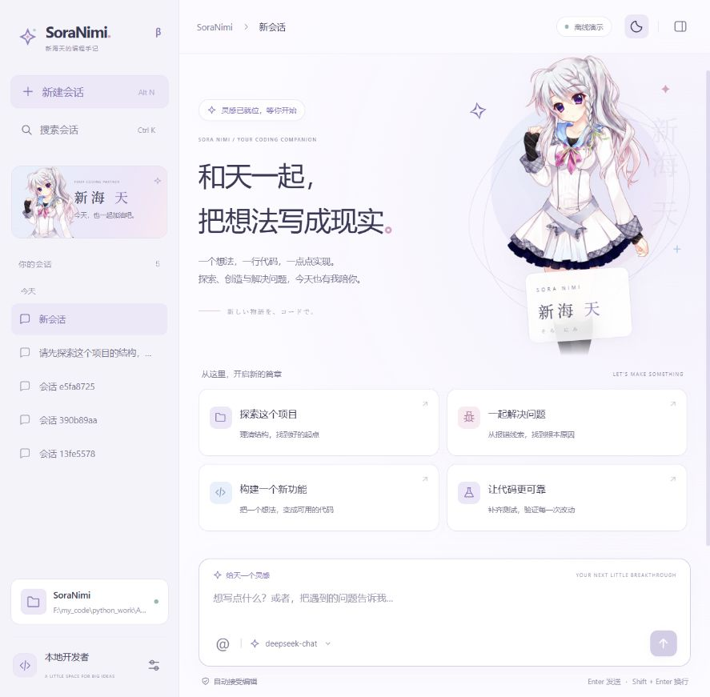

# SoraNimi Web 工作台

工作台采用“新海天”角色主题：银白、淡紫、冰蓝与樱粉配色，提供角色欢迎页、会话导航、聊天、工具活动、任务计划、文件差异和代码预览。默认浅色，支持灰紫夜间模式和窄屏抽屉布局。静态资源随 Python 包本地提供，设计与素材记录见 [新海天主题](nimi-theme.md)。



## 启动

使用已有 conda 环境，无需创建 `.venv`：

```powershell
conda activate Lang
python -m pip install -e ".[ui,dev,mcp]"
python -m soranimi --ui
```

如果当前 shell 未激活 conda，可以直接运行：

```powershell
& 'F:\miniconda3\envs\Lang\python.exe' -m soranimi --ui

# 离线演示，不调用真实模型
./start-ui.ps1 -Demo

# 指定工作区、模型和端口
python -m soranimi --ui --workspace F:\my_project --model deepseek:deepseek-chat --port 8877
```

打开终端中显示的 `http://127.0.0.1:8765`。Ctrl+C 关闭服务器。另一个等价入口是 `python -m soranimi.web.launcher` 或安装后的 `soranimi-ui`。

真实任务的 API Key 从启动工作区的 `.env` 或环境变量读取，修改 `.env` 后应重启服务。界面不会保存或返回 Key。演示模式始终使用只读的 `DemoModel`，在设置中选择模型也不会产生真实 API 调用。

## 操作

- **新建会话**：点击左侧按钮或 Alt+N；侧栏保留历史会话，Ctrl+K 搜索。
- **发送任务**：Enter 发送，Shift+Enter 换行；中文输入法确认候选词时不会提前发送。
- **模型与权限**：点击输入框底部的模型名或权限标签。设置用于新会话，已有 Web 会话保留各自的模型、权限和执行环境。
- **工具执行**：聊天内工具记录可展开参数和结果；右侧实时显示执行状态，计划来自 Agent 的 `update_plan`。
- **审批**：显示具体工具、风险与参数；明确允许或拒绝后才继续。审批持久化到 SQLite，刷新页面或重启服务器后仍可处理。
- **暂停**：当前模型/工具步骤完成后暂停，不强制杀死正在运行的命令；“继续任务”从检查点续接。暂停和工具审批使用不同图节点，避免把继续任务误当成批准操作。
- **查看变更**：右侧“变更”列出本次会话 edit/write 的文件差异，点击预览 diff；撤销检查当前文件内容，避免覆盖后续用户修改。命令或外部工具的全部副作用不在文件快照范围内。
- **浏览文件**：右侧“文件”支持过滤、文本预览与复制；预览中的“引用此文件”把 `@路径` 放进输入框，由 Agent 根据任务读取。预览本身不授予 Agent 文件编辑资格。
- **主题**：右上角切换深色/浅色，选择保存在当前浏览器。

旧 CLI 会话也会显示在同一工作区列表中。由于旧元数据不包含权限模式，UI 使用它们时采用手动审批；新 Web 会话保存权限设置。CLI 的参数、`--resume` 和斜杠命令保持可用。

## 本地服务与并发

服务器只监听 `127.0.0.1`，不提供公网部署选项。API 使用 HttpOnly / SameSite Cookie、同源检查、自定义请求头与 Host 校验；前端以 DOM 渲染文本和 Markdown，不执行模型输出中的 HTML、脚本或远程图片。

单个工作台进程同一时间只执行一个工作区任务；浏览器断线不会中止任务，重连会恢复事件或加载最终检查点。多个工作台进程或 CLI 之间不共享此互斥锁，应避免同时修改同一项目。

## 实现与验证

- `src/soranimi/web/app.py`：FastAPI、本地访问边界、API 与静态资源。
- `src/soranimi/web/service.py`：线程内资源管理、SSE、会话恢复、审批和撤销。
- `src/soranimi/web/static/`：无构建步骤的 UI、Markdown 渲染、主题和响应式布局。
- `tests/test_web.py`：真实 HTTP/SSE、审批前无副作用、拒绝与恢复、变更撤销、路径边界、并发互斥、暂停后的审批隔离。

```powershell
conda activate Lang
python -m pytest -q
python -m ruff check src tests
python -m ruff format --check src tests
node --check src/soranimi/web/static/app.js
node --check src/soranimi/web/static/markdown.js
```

Node 仅用于开发时的可选语法检查，不是运行工作台的依赖。

## 上传与解析文档

输入区点击「上传文档」，选择 TXT/MD/CSV/JSON/LOG/TSV、PDF、DOCX 或 PPTX。等待解析完成后点击附件名称可预览提取文本；勾选要引用的附件，再输入问题并发送。不填写问题时默认总结所选附件。附件按会话保存，刷新后仍可重新勾选。

上传只在本机解析和保存；发送任务时才向当前模型提供所选文件的文本，必要时 Agent 会用 `read_attachment` 继续分页读取。上传内容属于参考资料，其中的指令不代表用户授权。请勿上传不希望模型访问的敏感文件。

单文件上限 20 MiB、单次引用上限 8 个，每会话最多 20 个文件和累计 100 MiB。解析文本上限 50 万字符，超过时显示截断提示。扫描件需先 OCR；加密文档需先解密；旧 `.doc`/`.ppt` 需先另存为 `.docx`/`.pptx`。当前解析文本、表格内容和页/幻灯片标记，不还原完整视觉版式或读取图片内容。
